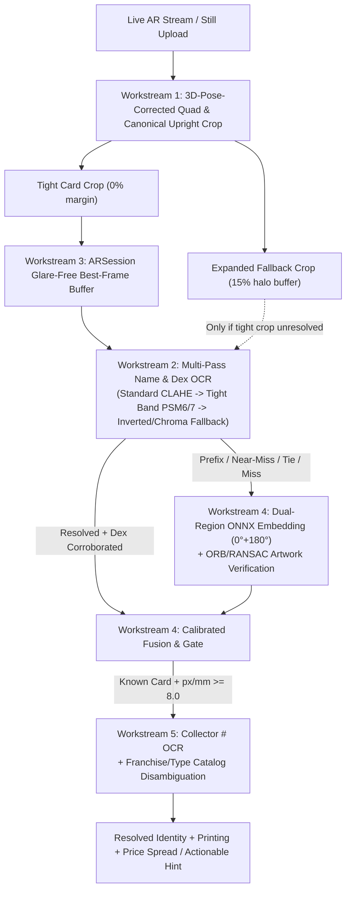

# Bakugo Expansion Plan: Higher Consistency of Visual Card Recognition

**Target Baseline:** `v2.33.1` (`9857dc8`, branch `main`)  
**Scope:** End-to-end visual card recognition across Live AR, Freeze/still capture, and Batch scanning — from localization and rectification through species/title identification and exact-printing disambiguation.

> [!IMPORTANT]
> **Core Non-Negotiable Invariant:** Bakugo's safety guarantee (verified in [`tests/test_recognise.py`](file:///c:/Users/agard/Documents/VS%20Code/Bakugo/tests/test_recognise.py) and [`ocr.py`](file:///c:/Users/agard/Documents/VS%20Code/Bakugo/cardcenter/ocr.py)) is that **a confident wrong identification costs far more than abstention**. Every expansion below increases *consistency and recall* across handheld tilts, shop glare, sleeves, and cold starts by adding orthogonal evidence and fixing upstream crop corruption — never by loosening false-accept protections.

---

## 1. Diagnosed Consistency Bottlenecks (Verified in Codebase)

Inspection of the `v2.33.1` pipeline reveals six structural reasons the same physical card is recognized intermittently across frames, lighting angles, and devices:

| Layer | Current Behavior in Codebase | Failure Mode Observed / Implied |
|---|---|---|
| **1. Pose & Orientation Geometry** | [`enforce_portrait`](file:///c:/Users/agard/Documents/VS%20Code/Bakugo/cardcenter/geometry.py#L49-L55) checks 2D pixel side lengths (`e01 > e12`). [`recognise_card`](file:///c:/Users/agard/Documents/VS%20Code/Bakugo/cardcenter/recognise.py#L539-L555) only tries `0°` and `180°`. | Past `~42°` pitch tilt (allowed up to `MAX_TILT_DEG = 62.0°` in [`scene.py`](file:///c:/Users/agard/Documents/VS%20Code/Bakugo/cardcenter/scene.py#L56)), the long axis foreshortens below the short axis, rotating the rectified crop **90° sideways**. `NAME_BAND` lands on a side border and OCR sees nothing. |
| **2. Rectification Margin Bleed** | [`_rectify_for_reading`](file:///c:/Users/agard/Documents/VS%20Code/Bakugo/cardcenter/serve.py#L608-L622) adds `READ_MARGIN_FRAC = 0.15` top/bottom and includes the top background margin in `band`; [`_identify_payload`](file:///c:/Users/agard/Documents/VS%20Code/Bakugo/cardcenter/serve.py#L692) feeds that raw `rect` directly into `embed_crop`. | (a) Adjacent cards above the target in a binder/counter enter the primary `NAME_BAND`; (b) [`read_band`](file:///c:/Users/agard/Documents/VS%20Code/Bakugo/cardcenter/recognise.py#L523-L532) slices `img[:hi]` ignoring `lo`; (c) `embed_crop` receives `15%` replicated margins **plus unaligned `0°/180°` flip**. |
| **3. Single-Pass OCR Limitations** | [`prepare_for_text`](file:///c:/Users/agard/Documents/VS%20Code/Bakugo/cardcenter/recognise.py#L221-L236) applies a single fixed grayscale CLAHE + `tesseract --psm 11`. | Unlike [`preprocess_number_crop`](file:///c:/Users/agard/Documents/VS%20Code/Bakugo/cardcenter/ocr.py#L181-L204), name OCR has no **polarity inversion** for light text on dark/full-art/Tera backgrounds, no line/block PSM on tight name bars, and no glare-channel resilience. |
| **4. No Temporal AR Recognition Fusion** | [`ARSession.push`](file:///c:/Users/agard/Documents/VS%20Code/Bakugo/cardcenter/ar.py#L1075) fuses centering and surface/corner evidence over time; [`_identify_payload`](file:///c:/Users/agard/Documents/VS%20Code/Bakugo/cardcenter/serve.py#L625) runs on one still shot. | A transient reflection across a few letters (e.g. `"Fletch"` in `v2.32.0`) stalls identification on the auto-captured frame even when frames 200 ms earlier had clear letters. |
| **5. Disconnected Visual Verification & Cold Start** | [`orb_signature`](file:///c:/Users/agard/Documents/VS%20Code/Bakugo/cardcenter/catalog.py#L243) / `match_score` is never called in serving paths. Service worker embeddings ([`sw.js`](file:///c:/Users/agard/Documents/VS%20Code/Bakugo/cardcenter/static/sw.js)) are veto-only and empty until a device confirms ≥3 cards ([`IdGateConfig`](file:///c:/Users/agard/Documents/VS%20Code/Bakugo/cardcenter/confidence.py#L149-L154)). | Visual similarity cannot rescue partial/glared OCR reads (`prefix_candidates`, `near_miss`, `alternatives`), cannot run on cold-start shop visits, and is not geometrically verified via ORB+RANSAC. |
| **6. Evaluator & Printing/Catalog Gaps** | [`eval/recognition_eval.py`](file:///c:/Users/agard/Documents/VS%20Code/Bakugo/eval/recognition_eval.py#L147) and [`trainer/pseudo.py`](file:///c:/Users/agard/Documents/VS%20Code/Bakugo/trainer/pseudo.py#L70) still call legacy `find_card_quad`. `/identify` ignores `read_collector_number`, `Trainer/Energy` titles (`_BOILERPLATE`), and trained artifacts (`quad_detect`, `ocr_preprocess`, `ConfusionModel`). | Evaluator detection underperforms production (`0/17` field checks for legacy `find_card_quad`); Trainer/Supporter/Item/MTG cards fail; printing variants aren't surfaced automatically in `/identify`. |

---

## 2. Target Architecture: Multi-Cue Recognition Pipeline

---

## 3. Expansion Workstreams (Ordered by Impact & Dependency)

### Workstream 1: Upstream Geometric & Crop Consistency
*Eliminate silent crop, margin, and rotation errors before recognition sees pixels.*

1. **3D-Pose Portrait Disambiguation (`scene.py`, `geometry.py`)**
   - In [`card_pose_batch`](file:///c:/Users/agard/Documents/VS%20Code/Bakugo/cardcenter/scene.py#L261) and [`card_pose`](file:///c:/Users/agard/Documents/VS%20Code/Bakugo/cardcenter/scene.py#L219), expose which un-projected world vector (`a1` vs `a2`) corresponds to the physical short axis (`63.5 mm`) vs long axis (`88.9 mm`).
   - Use the recovered 3D edge lengths instead of 2D pixel lengths when ordering the quad into portrait frame whenever a camera pose succeeds, falling back to 2D `enforce_portrait` only when planar pose is degenerate.
   - Add `90°` and `270°` name-band fallback checks inside [`recognise_card`](file:///c:/Users/agard/Documents/VS%20Code/Bakugo/cardcenter/recognise.py#L486) (gated cleanly behind failure of `0°`/`180°` passes, at negligible latency cost on normal upright/inverted cards) to catch steep-tilt swaps and landscape cards.

2. **Decouple Tight Recognition Crops from Fallback Halo Crops (`serve.py`, `recognise.py`)**
   - In [`_rectify_for_reading`](file:///c:/Users/agard/Documents/VS%20Code/Bakugo/cardcenter/serve.py#L608), produce:
     - **Primary crop (`rect_tight`)**: exact card boundary (`mx=0.02*w, my=0.02*h`), avoiding neighbour-card text in binder sheets and bulk bins.
     - **Fallback crop (`rect_margin`)**: `READ_MARGIN_FRAC = 0.15` used *only* when the tight crop returns zero name-band characters (preserving the `v2.20.0 Meganium` fix for sleeved halo outlines without polluting normal reads).
   - Fix [`read_band`](file:///c:/Users/agard/Documents/VS%20Code/Bakugo/cardcenter/recognise.py#L523-L532) to slice `[int(name_band[0] * h) : int(name_band[1] * h)]` accurately instead of `[:int(name_band[1] * h)]`.
   - Fix `embed_crop` in [`_identify_payload`](file:///c:/Users/agard/Documents/VS%20Code/Bakugo/cardcenter/serve.py#L692) so it is always generated from **tight interior coordinates (`0%` replicated background)** and **oriented upright** using `rec.orientation` when resolved (with 0°+180° dual query in `sw.js` when `rec.orientation` is uncertain).

3. **Unify Offline Eval & Pseudo-Labeler Localization + Wire `quad_detect`**
   - Update [`eval/recognition_eval.py`](file:///c:/Users/agard/Documents/VS%20Code/Bakugo/eval/recognition_eval.py#L143-L153) (`--detect`) and [`trainer/pseudo.py`](file:///c:/Users/agard/Documents/VS%20Code/Bakugo/trainer/pseudo.py#L68-L76) to invoke `framing.locate_coarse_to_fine` + `edge_information.locate_card` rather than legacy `geometry.find_card_quad`.
   - Wire `release_guard.released_params("quad_detect")` into [`framing.py`](file:///c:/Users/agard/Documents/VS%20Code/Bakugo/cardcenter/framing.py) / [`geometry.py`](file:///c:/Users/agard/Documents/VS%20Code/Bakugo/cardcenter/geometry.py#L720) (resolving the open item in [`docs/PRIVATE_TRAINER.md`](file:///c:/Users/agard/Documents/VS%20Code/Bakugo/docs/PRIVATE_TRAINER.md#L169)).

---

### Workstream 2: Multi-Pass Adaptive Name OCR & Confusion Scoring
*Make glyph extraction consistent across foil, dark frames, and uneven shop lighting without lowering the acceptance bar.*

1. **Targeted Escalation Cascade (`recognise.py`)**
   - **Pass 1 (Fast Path, unchanged latency):** Existing `prepare_for_text` (CLAHE 2.0) + `psm 11` whole-card and upright/180° check.
   - **Pass 2 (Structured Name-Bar Strip):** If Pass 1 is unresolved or uncorroborated, crop only the left ~70% of the name band (excluding `Basic/Stage` badge noise on the left edge and `HP ###` / energy icon on the right that produced `"TRMIGE"` / `"Mr. Mime"` false near-misses in `v2.32.0`) and run `psm 7` / `psm 6` across:
     - **Polarity-inverted crop** (`bitwise_not`, reusing [`ocr.preprocess_number_crop`](file:///c:/Users/agard/Documents/VS%20Code/Bakugo/cardcenter/ocr.py#L181) adaptive Otsu/bilateral logic) for dark-type, ancient/future, VMAX, and Tera cards;
     - **Lab Lightness + Best Chromatic Gradient Projection** to pull colored foil lettering out when luminance is flattened by overhead spotlights.
   - **Invariant Preservation:** All passes remain gated by `_allowed_edits` (`<=5 -> 0`, `<=8 -> 1`, `>8 -> 2`), `_BOILERPLATE` filtering, `"Evolves {rom"` suppression, unique-closest matching, and Dex cross-checking.

2. **Confusion-Weighted Tie-Breaking & Near-Miss Ranking (`learning.py`, `recognise.py`)**
   - Wire `learning.ConfusionModel` into `recognise.py` as a **tie-breaker and near-miss confidence scorer** (keeping the strict hard-cap on raw Levenshtein edit distance so distant tokens never sneak in, while preferring photorealistic OCR substitutions like `rn↔m`, `l↔1↔I`, `{↔f`, `0↔O`).
   - Populate clean confusion counts from owner-verified corrections (`owner_token_matches` / `trainer`), preventing feedback loops from unconfirmed user actions.

---

### Workstream 3: Temporal & Multi-View AR Recognition Fusion (`ARSession`)
*Leverage continuous AR video instead of staking everything on one Freeze shutter.*

1. **Per-Card `RecognitionEvidence` Buffer in `ARSession` (`ar.py`)**
   - Extend `ARSession` (which already tracks card continuity across frames via IoU and front/back flips within `FLIP_WINDOW_S = 8.0`) with a ring buffer of up to 4 sharp, glare-minimized rectified crops (`glare_frac` inside `NAME_BAND`, scored by stroke gradient variance).
   - **Anti-Glare Multi-Frame Consensus:**
     - As the user slightly tilts a sleeved card in AR, specular highlights slide off the title bar. When Freeze / auto-capture runs, `/identify` receives both the fresh still **and** can fall back cleanly to (or fuse tokens across) the sharpest glare-free live frame/mosaic (`session.last_detail_image`) captured within the last ~3 seconds for that same card.
     - Fuse compatible partial hypotheses across views of the *same tracked card*: e.g., if Frame 1 gives `prefix_candidates("Fletch") -> [Fletchling, Fletchinder]` and Frame 2 (after 0.5° tilt) resolves `Fletchinder` or reads `NO. 0662`, upgrade cleanly to corroborated `Fletchinder` even if a second reflection obscures the final shot.

2. **Glare-Aware Live HUD Coaching (`serve.py`, `ar.py`)**
   - Surface targeted live guidance when identification tracking hits localized title glare (`"Glare on card name — tilt phone slightly before freezing"`) rather than auto-capturing a glare-blinded still after `AUTO_STILL_MS = 300 ms`.

3. **Batch Scan Crop Handoff (`multicard.py`)**
   - Retain `ScannedCard.best_crop` (sharpest un-glared rectified thumbnail) during wide display-case / binder-page scans so each deduplicated card can pass straight into batched species + embedding identification.

---

### Workstream 4: Calibrated Visual Matching & Dual-Region Embeddings
*Make visual recognition work when text is unreadable (foreign cards, heavy holo wash, extreme blur, cold start).*

1. **Dual-Region Crop & 0°/180° TTA in the Embedding Worker (`static/sw.js`, `embed.py`)**
   - Extract embeddings over **two aligned regions** (full upright card + central artwork panel `[0.16..0.54 H, 0.08..0.92 W]`) or multi-crop average to gain strong invariance against sleeve glare, border scuffs, and bottom rules text variations.
   - When orientation from OCR is uncertain, score both `0°` and `180°` orientations in the service worker and keep the higher cosine similarity.

2. **ORB + RANSAC Geometric Verification on OCR Shortlists (`catalog.py`, `serve.py`)**
   - Wire existing [`catalog.orb_signature`](file:///c:/Users/agard/Documents/VS%20Code/Bakugo/cardcenter/catalog.py#L243) and `match_score` (currently unused in `_identify_payload`) whenever:
     - OCR emits a constrained shortlist (`prefix_candidates` such as `Fletch -> [Fletchling, Fletchinder]`, or `alternatives` ties, or `near_miss`), AND catalog reference artwork is cached locally or fetched opt-in.
     - Require `inliers >= 12` (homography RANSAC consistent geometry), turning ambiguous/glared OCR reads into high-precision verified matches.

3. **From Veto-Only to Ranked Candidate Corroboration (`confidence.py`, `serve.py`)**
   - Update [`gate_identification`](file:///c:/Users/agard/Documents/VS%20Code/Bakugo/cardcenter/confidence.py#L157) without lowering `Decision.ACCEPT` rigor:
     - Keep `ACCEPT` strict (`OCR + Dex` OR `OCR + high-margin Embedding/ORB` on a resolvable, low-shot-noise frame).
     - When `Decision.REVIEW` occurs (e.g., OCR failed, gave a prefix, or shot noise exceeded `1.6x`), allow visual top-K matches from the embedding worker / ORB to populate **one-tap confirmation suggestions** in [`serve.py`](file:///c:/Users/agard/Documents/VS%20Code/Bakugo/cardcenter/serve.py#L2985) instead of forcing manual typing.

4. **Trainer & Public Reference Embeddings Within Privacy Rules (`release_guard.py`)**
   - Strictly preserve the Contamination Firewall (`release_guard.py` forbids shipping private `card_index` / `embedding_index`). Keep device confirmations in IndexedDB.
   - Add an **opt-in public catalog pack** mechanism (derived solely from public APIs like PokémonTCG/Scryfall artwork and completely separate from private collection data) or trainer-evaluated `model.onnx` selection so cold-start devices have non-empty reference utility from Scan #1.

---

### Workstream 5: Vocabulary, Non-Species Cards & Printing Disambiguation
*Recognize Trainer/Energy/multi-TCG cards and pinpoint the exact printing whenever resolution allows.*

1. **Expand Closed Vocabulary Beyond Species #1–1025 (`species.json`, `recognise.py`)**
   - Add curated public **Trainer / Supporter / Item / Tool / Stadium / Special Energy** card titles so modern staples (`Boss's Orders`, `Nest Ball`, `Professor's Research`) aren't dropped by `_BOILERPLATE` or rejected as "outside vocabulary".
   - Enforce context-gating: require explicit sub-banner markers (`Trainer`, `Item`, `Supporter`, `Stadium`) in `NAME_BAND` when matching generic Trainer phrases to prevent ordinary rules-text words from triggering false hits.

2. **Franchise & Front-Layout Routing (`cardtype.py`, `hue_reference.py`)**
   - Use card-back classification (`hue_reference.classify_back` in `ARSession` across flips) and front structural markers (Pokémon `HP ###` / `NO. ####` vs MTG mana symbols / type line vs Yu-Gi-Oh! attribute orb / 8-digit passcode) to select the right vocabulary/catalog (`ScryfallCatalog` for MTG vs Pokémon closed vocab).

3. **Integrate `read_collector_number` into `/identify` (`ocr.py`, `catalog.py`, `serve.py`)**
   - When the card name resolves and `px_per_mm >= 8.0` (`FEATURE_SIZE_MM["collector_number"] * px_per_mm >= 12.0 px`), extract both bottom-left (modern Pokémon/MTG) and bottom-right (classic Pokémon / alternative layouts) ROIs and call [`ocr.read_collector_number`](file:///c:/Users/agard/Documents/VS%20Code/Bakugo/cardcenter/ocr.py#L264) constrained to real catalog printings for that name.
   - Expose `printing` candidates, `resolved_printing`, and `price_spread` in `_identify_payload` (surfacing `"Zoom in to separate 18 printings ($1.50 – $240)"` cleanly in UI).

---

### Workstream 6: Evaluation Harness, Field-Log Replay & Nightly Trainer Loop
*Prevent regressions and prove every gain on real shop frames.*

1. **Stratified Field Benchmark (`eval/recognition_eval.py`)**
   - Expand manifests with annotated real captures from [`tests/fixtures/field/`](file:///c:/Users/agard/Documents/VS%20Code/Bakugo/tests/fixtures/field/README.md) and `/data/field` (`fieldlog.py`) failures (e.g., `Thievul`, `Fletchinder`, `Meganium`, `Terapagos`, dark/foil cards, upside-down/45°-tilted cards).
   - Report **auto-accept precision**, **coverage**, **suggest-hit@3**, and **wrong-name rate (target: ≤ 0.5% on accepted)** sliced by resolution (`<6`, `6–9`, `9–12`, `>=12 px/mm`) and condition (`glare`, `dark_foil`, `sleeved`, `tilted > 30°`, `multi_card`).

2. **Automated `ocr_preprocess` Trainer Task (`trainer/tasks.py`)**
   - Implement `OcrPreprocessTask` producing the scalar `ocr_preprocess` generic artifact already allowlisted in [`release_guard.GENERIC_KINDS`](file:///c:/Users/agard/Documents/VS%20Code/Bakugo/cardcenter/release_guard.py#L45) (CLAHE clip limit, name-band coordinates, polarity threshold, confusion weightings).
   - Promote via `night`/`dawn` paired bootstrap strictly on held-out `confirmed` frozen test items (`max_slice_drop = 0`, zero increase in false-accepts).

---

## 4. Recommended Execution Sequence

| Phase | Deliverables | Primary Success Metric |
|---|---|---|
| **Phase 1: Clean Inputs & Eval Parity** | Workstream 1 (`3D pose orientation`, `90°/270° retry`, tight vs margin crop split, upright `embed_crop`, `eval` locator alignment, wire `quad_detect` artifact) | Fix silent 90°/180° orientation misses & crop contamination; establish truthful baseline in `recognition_eval.py`. |
| **Phase 2: Multi-Pass Name OCR & AR Fusion** | Workstream 2 + 3 (`read_band` polarity inversion & left-crop `psm 6/7`, `ARSession.RecognitionEvidence` anti-glare buffer, glare warning) | Cut single-frame glare/foil/dark-card misses on field stills and shop AR videos while keeping false-accepts at 0 on regression corpus. |
| **Phase 3: Visual Matching & Shortlist Rescue** | Workstream 4 + 5.1 (`orb_signature` RANSAC shortlist verifier, dual-region `sw.js` embeddings + 1-tap suggestions, Trainer/Energy closed vocabulary) | Recover unresolved/prefix/non-species cards without manual typing. |
| **Phase 4: Exact Printing & Continuous Tuning** | Workstream 5.2–5.3 + 6 (`read_collector_number` wiring in `/identify`, `ConfusionModel` + `OcrPreprocessTask` nightly promotion) | End-to-end printing disambiguation & automated improvement loop over real field captures. |
